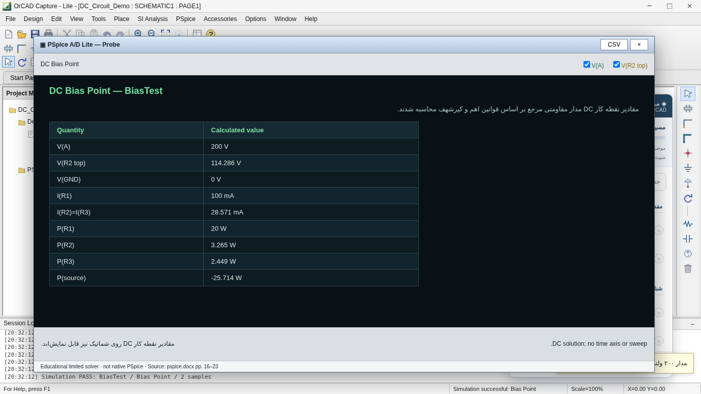
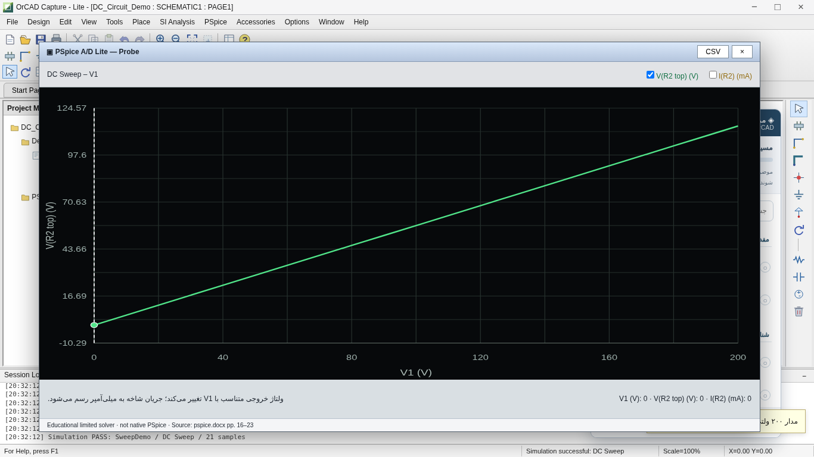

# ⚡ Ohm My Vibe!

### Circuit theory meets vibe coding.

**An unofficial, offline-first, Persian-language interactive learning environment inspired by PSpice and OrCAD Capture.**

[](https://github.com/maklf-dev/ohm-my-vibe/releases/tag/v0.7.0)


[](https://github.com/maklf-dev/ohm-my-vibe/releases/download/v0.7.0/PSpice_OrCAD_Offline_Phase6_v0.7.0.zip)

**[All releases](https://github.com/maklf-dev/ohm-my-vibe/releases)** · **[Report an issue](https://github.com/maklf-dev/ohm-my-vibe/issues)** · **[Developer](https://github.com/maklf-dev)**

> [!IMPORTANT]
> **Work in progress — Phase 6 of 8.** This is an independent educational reconstruction, **not** official PSpice/OrCAD software, and **not** a general-purpose SPICE simulator. The 82% figure is weighted roadmap completion, not simulation accuracy or production readiness.

## 📖 About

**Ohm My Vibe!** is a browser-based project for Persian-speaking students who want to explore circuit design, schematic editing, and simulation concepts in an interface inspired by classic OrCAD Capture and PSpice workflows.

The application combines:

- A Capture-inspired schematic workspace
- A Persian guided-learning center
- Interactive circuit construction and connectivity checks
- **Educational** DC and RC analysis tools
- An offline Probe-style chart viewer
- A welcome screen, installation walkthrough, and reference resources

Built using **vanilla HTML, CSS, and JavaScript**, with no required backend, npm installation, or remote simulation service.

## ✨ What's new in v0.7.0 — Phase 6

Phase 6 extends the schematic editor from v0.6.0 with **working analysis flows for a specifically supported reference circuit and standalone RC demonstrations**.

### 1. Simulation profiles

- **PSpice → New Simulation Profile** and **Edit Simulation Profile** workflows
- Create and name profiles
- Configure analysis-specific parameters in a Simulation Settings dialog
- Save the profile together with the educational circuit JSON

### 2. DC Bias Point

For the supported 200 V reference circuit, calculate:

- Node voltages
- Branch currents
- Resistor and source power
- Voltage/current/power labels on the schematic (`V`, `I`, `W`)
- Tabulated results in the Probe-style window

The solver **validates the expected topology and wiring before running**; it does not solve arbitrary user-designed circuits.

### 3. DC Sweep

- Sweep source `V1` linearly using Start, End, and Increment
- Recalculate the supported circuit at each step
- Plot `V(R2 top)` and `I(R2)`
- Export computed samples as CSV

### 4. Time Domain (Transient)

- Show the **correct flat time response** of the reference circuit under a constant DC source
- Configure run duration, save start time, and displayed sampling step
- Explore a **separate analytical RC step-response example** for time-varying behavior

The RC example is **not** simulated from the Capture schematic. The maximum-step setting controls plotted sample density, not a SPICE adaptive integration algorithm.

### 5. AC Sweep / Noise menu

- Explore a **separate analytical RC low-pass filter example**
- Adjust resistance and capacitance
- Plot frequency-dependent gain in dB and phase in degrees
- Use separate scales for gain and phase

**Noise analysis and general AC simulation of the drawn schematic are not implemented.**

### 6. Offline Probe-style results

- SVG-based plotted curves generated from computed data
- Toggle curve visibility
- Click plots to inspect sample values
- Export CSV data
- Dark, classic-inspired visualization

### 7. Learning and regression improvements

- Seven simulation-related learning topics now connect to executable demonstrations instead of preview-only flows
- The existing **16-topic Persian learning center** remains available
- Phase 5 schematic editing and connectivity validation are preserved
- The earlier legacy RC demo remains separate and accessible

## 🖼️ Preview

*These paths assume the repository root contains the extracted `PSpice-Offline` files.*

| DC Bias Point | DC Sweep |
|---|---|
|  |  |

> Preview images are illustrative. Actual interaction is available in the application.

## 📥 Download and run

1. Click **Download v0.7.0 ZIP** above or visit [Releases](https://github.com/maklf-dev/ohm-my-vibe/releases).
2. Download **`PSpice_OrCAD_Offline_Phase6_v0.7.0.zip`**.
3. Extract the complete ZIP without changing its relative folder structure.
4. Open **`PSpice-Offline/index-standalone.html`** with a current Chrome or Edge browser.
5. From the Persian welcome screen, enter the simulated workspace.
6. Load the sample schematic using **Load sample schematic**.
7. Run the connectivity check, then choose **PSpice → New Simulation Profile**.
8. Select an analysis, configure it, and choose **PSpice → Run**.
9. Inspect results in the Probe window or use `V`, `I`, and `W` overlays.

**No installer, Node.js, npm, or backend is needed by the application design.** Some optional links to official software and documentation require internet access.

**Browser testing caveat:** Direct `file://` execution was blocked by the test environment's administrative policy. The bundled HTML/CSS/JS was tested through browser content injection, so direct local-file compatibility on every computer has **not** been independently confirmed.

### Save and reopen your work

Use **File → Save** to download an educational JSON document containing supported components, wires, libraries, and simulation-profile settings. Use **File → Open** to restore it. This is **not** native OrCAD `.dsn` or `.opj` support.

## 🔬 Reference circuit and verified calculations

The supported DC circuit has a **200 V DC source**, with `R1` in parallel with the series combination of `R3` and `R2`.

| Component | Value |
|---|---:|
| V1 | 200 V |
| R1 | 2 kΩ |
| R2 | 4 kΩ |
| R3 | 3 kΩ |

With the default values:

| Measurement | Expected value |
|---|---:|
| Current through R1 | 100 mA |
| Current through R2 and R3 | 28.571429 mA |
| Voltage at top of R2 | 114.285714 V |
| Power in R1 | 20 W |
| Power in R2 | ≈ 3.265306 W |
| Power in R3 | ≈ 2.448980 W |
| Source power (passive sign convention) | ≈ −25.714286 W |

The negative source-power value indicates power **delivered** by the source.

## 🗂️ Project structure

```text
.
├── index-standalone.html        # Recommended self-contained HTML entry
├── index.html                   # Modular development entry
├── capture.js / capture.css     # Capture-inspired workspace
├── phase5.css                   # Schematic editing additions
├── phase6.js / phase6.css       # Analysis workflows and Probe
├── tutorial-manager.js / .css   # Persian learning center
├── welcome.js / welcome.css     # Welcome and installation guide
├── welcome.html.frag
├── examples/                    # Educational circuit JSON examples
├── legacy/                      # Earlier independent RC demonstration
├── reference/                   # Reports, images, previews, metadata
├── reference-atlas.html
├── vendor/                      # Placeholder Driver.js assets
├── README-FA.md                 # Persian usage guide
├── PHASE-6-REPORT-FA.md         # Phase 6 design and calculation details
└── PHASE-6-TEST-REPORT-FA.md    # Phase 6 test report
```

The structure above assumes the contents of `PSpice-Offline/` are committed at the repository root. If the directory is committed as a nested folder, adjust the relative documentation and image links.

## 🧭 Development roadmap

| Phase | Scope | Status |
|---|---|---|
| 1 | Baseline, source inventory and preservation | ✅ Complete |
| 2 | Capture-inspired interface reconstruction | ✅ Complete |
| 3 | Persian interactive learning center | ✅ Complete |
| 4 | Welcome, history, installation and resources | ✅ Complete |
| 5 | Schematic editor, component libraries and connectivity | ✅ Complete |
| **6** | **Simulation profiles, supported DC analyses, RC demonstrations and Probe** | **✅ Complete — v0.7.0** |
| 7 | Integrate the real, locally bundled Driver.js library and expand guided lessons | ⏳ Planned |
| 8 | Final offline validation, visual polish and release hardening | ⏳ Planned |

**Roadmap: 6/8 phases complete, 82% weighted progress.** Remaining phases account for 18% of the planned work.

## 🧪 Testing

The bundled Phase 6 test report documents:

- Chromium checks at **1280×720**, **1366×768**, and **1920×1080**, with no JavaScript errors in tested flows
- Loading the reference schematic, validating connectivity, creating a profile, running analyses, and opening Probe
- Transient output: **1,001** points for a 100 ms run with 0.1 ms display step
- DC Sweep: **21** points from 0 to 200 V in 10 V increments, reaching 114.285714 V and 28.571429 mA
- DC Bias Point values and negative source-power convention
- Resistor edit: changing R1 from 2 kΩ to 4 kΩ changes its current from 100 mA to 50 mA and power from 20 W to 10 W
- Missing-wire validation prevents invalid DC Sweep results
- Invalid frequency settings produce validation feedback
- The previous 16 tutorial topics remain recognized

**Not verified:** unrestricted `file://` execution on end-user devices, full pixel fidelity to OrCAD 17.2, arbitrary-circuit simulation, and native Cadence project compatibility.

Read the [Phase 6 implementation report](PHASE-6-REPORT-FA.md) and [Phase 6 test report](PHASE-6-TEST-REPORT-FA.md) for details.

## ⚠️ Current limitations

- **Not a general-purpose SPICE engine.** The DC solver supports only the validated reference topology.
- No transistor models, arbitrary-circuit AC analysis, or noise solver.
- RC transient and AC examples use independent analytical models rather than the schematic netlist.
- No native `.dsn` or `.opj` import/export.
- `Maximum step size` affects chart sampling, not SPICE numerical integration.
- Plotting is capped at **1,600 samples** for browser responsiveness.
- The current guided tour uses a custom local engine; bundled Driver.js files are **placeholders**, pending Phase 7.
- Browser-specific local-file policies and full offline packaging still need end-user validation.

## 📚 References

Official and third-party resources used for educational cross-checking:

- [Cadence: Simulation Profiles](https://community.cadence.com/cadence_blogs_8/b/pcb/posts/simulationprofiles)
- [Cadence: Circuit simulation overview](https://resources.academic.cadence.com/circuit-simulation/2025-how-to-simulate-pcb-design)
- [FlowCAD: PSpice 17.2 quick-start PDF (German)](https://www.flowcad.de/PSpice_Schnellstart_17_2.pdf)
- [Cadence OrCAD Academic](https://www.cadence.com/en_US/home/tools/pcb-design-and-analysis/orcad/academic.html)
- [PSpice for TI](https://www.ti.com/tool/PSPICE-FOR-TI)

These references are **not bundled installers** and are not required for running the educational application. Phase 6 added no external runtime dependency.

## 🤝 Feedback and contributions

Issues, bug reports, corrections to educational content, and accessibility feedback are welcome through [GitHub Issues](https://github.com/maklf-dev/ohm-my-vibe/issues). Please avoid submitting proprietary Cadence binaries or third-party assets without redistribution permission.

## ⚖️ License and legal notice

**No open-source license has been selected for this repository.** Public visibility does not grant a general license to reuse, modify, or redistribute the original code.

This is an **independent, unofficial educational project** and is not affiliated with, endorsed by, or sponsored by Cadence Design Systems, Inc. Cadence, OrCAD, and PSpice are names or trademarks of their respective owners, used only for identification and educational reference.

The package includes reference images extracted from educational source material. **Their redistribution rights must be reviewed before public release.** Any future license covering original code would not automatically cover third-party materials.

## 👨‍💻 Author

Built with curiosity, circuit theory, and a suspicious amount of vibe coding by **[maklf-dev](https://github.com/maklf-dev)**.

If you find this project useful, a GitHub ⭐ is appreciated.
