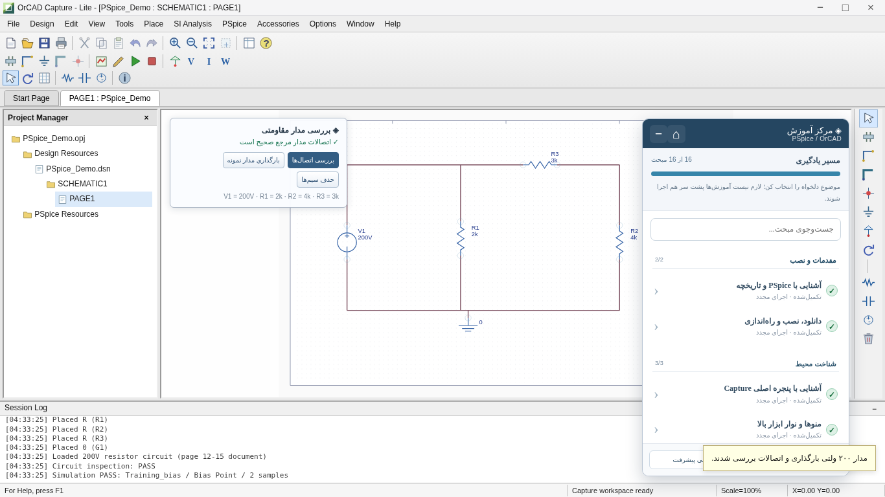
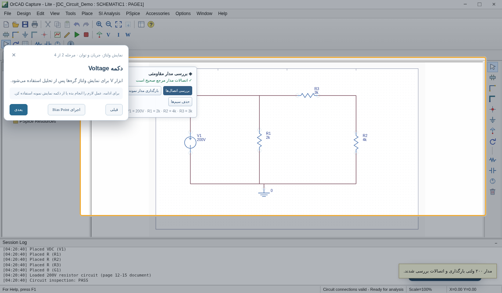
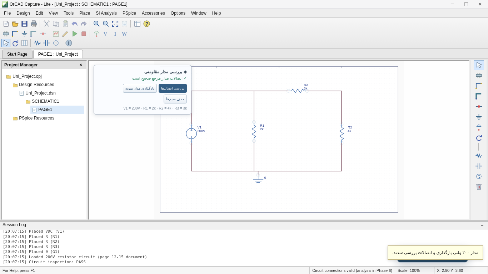

# ⚡ Ohm My Vibe!

### Circuit theory meets vibe coding.

**An unofficial, offline-first, Persian-language interactive learning environment inspired by classic PSpice and OrCAD Capture workflows.**

[](https://github.com/maklf-dev/ohm-my-vibe/releases/tag/v0.9.1)


[](https://github.com/maklf-dev/ohm-my-vibe/releases/download/v0.9.1/PSpice_OrCAD_Offline_Stability_v0.9.1.zip)

**[All Releases](https://github.com/maklf-dev/ohm-my-vibe/releases)** · **[Report an Issue](https://github.com/maklf-dev/ohm-my-vibe/issues)** · **[Developer](https://github.com/maklf-dev)**

> [!IMPORTANT]
> **Development preview, not official software.** Ohm My Vibe! is an independent educational reconstruction. It is **not** affiliated with Cadence, does **not** contain official PSpice/OrCAD binaries, and is **not** a general-purpose SPICE simulator. The reported **98%** refers to the project's *weighted development roadmap*, not production readiness or simulation coverage.

## 📖 About the Project

**Ohm My Vibe!** is a browser-based learning environment for Persian-speaking students exploring schematic editing, electronic-circuit concepts, and introductory circuit-analysis workflows.

Instead of requiring students to learn everything by reading menus and memorizing buttons, the project combines a classic Capture-inspired workspace with a **guided, interactive Persian tutorial system**. It is built with **HTML, CSS, and vanilla JavaScript** and is designed to run without a backend, a package manager, or runtime internet access.

### Highlights

- A classic **OrCAD Capture-inspired** project and schematic workspace.
- An interactive learning center containing **16 topics across 5 categories and 57 guided steps**.
- Guided actions with completion checks, step summaries, and explanatory formulas.
- A sample **200 V DC circuit**, editable components, wiring and connectivity validation.
- Educational **Bias Point, DC Sweep, Transient, and AC Sweep** demonstrations.
- An offline **Probe-style** results window with SVG plots and CSV export.
- JSON project save/open for the project's **own educational format**.
- An offline welcome screen, installation walkthrough, and reference gallery.
- A standalone HTML build alongside modular source files.

## 🆕 What's New in v0.9.1 — Offline Stability Update

This release builds on **v0.9.0**, focusing on tutorial stability and offline packaging rather than adding a new circuit-analysis engine.

### Improved tutorial engine lifecycle

- Fixed a lifecycle issue where the optional Driver.js instance could be discarded when starting a new lesson.
- When a genuine local Driver.js installation is available, the application creates an instance **per topic**, sets its steps, drives the tour, and cleans up the previous instance on topic changes or completion.
- Added the **active tutorial engine name** to the learning-center interface, making it clear whether the built-in guide or local Driver.js is being used.
- Preserved all **16 topics and 57 Persian steps**, including completion checks for practical tasks.

### New offline preparation tools

- Added `tools/Install-DriverJs.ps1` to **optionally** download the official **Driver.js v1.10.2** JavaScript, CSS, and license into local `vendor/` files on an internet-connected preparation computer.
- Added `tools/build_standalone.py` to regenerate the standalone HTML after editing modular source files or installing genuine Driver.js assets.
- Regenerated `index-standalone.html` with application CSS and JavaScript embedded and no automatic CDN dependency.
- Documented the exact optional library-installation steps in `vendor/README-DRIVERJS.txt`.

> [!WARNING]
> **The official Driver.js library is NOT included in this ZIP.** The bundled `vendor/` files are placeholders. The built-in Persian tutorial engine works offline without Driver.js. Real Driver.js integration is prepared but **has not yet been tested with the official library**; a mock API test is not equivalent to testing the genuine distribution.

## 🖼️ Preview

| Capture-inspired workspace | Persian interactive tutorials |
|---|---|
|  |  |

| Reference circuit | DC Sweep demonstration |
|---|---|
|  |  |

> The image paths above assume the **contents of `PSpice-Offline/` are placed at the repository root**. If you retain the top-level folder in Git, prefix each image path with `PSpice-Offline/`.

## 📥 Download & Quick Start

1. Click **Download v0.9.1 ZIP** above, or visit the [Releases page](https://github.com/maklf-dev/ohm-my-vibe/releases).
2. Download `PSpice_OrCAD_Offline_Stability_v0.9.1.zip`.
3. **Extract the entire archive**. Keep the `reference/` directory and other folders in place.
4. Open `PSpice-Offline/index-standalone.html` in a current **Chrome** or **Microsoft Edge** browser.
5. On the Persian welcome screen, enter the Capture-inspired workspace.
6. Select **Load sample schematic**, then use **Check Connections** to validate it.
7. Select **PSpice → New Simulation Profile**, create a profile, and configure an analysis.
8. Select **PSpice → Run** to see the calculated table or chart in the Probe-style window.
9. Open the floating **Learning Center** to follow guided lessons.

**Normal use requires no Node.js, npm, web server, or external simulation service.** The standalone HTML embeds the application styles and scripts; the image gallery still uses **relative local image paths**, so do not move that HTML out of its extracted folder.

**Important compatibility note:** The test environment blocked direct `file://` and `http://127.0.0.1` navigation through its administrator policy. Tests used Chromium with the full HTML loaded into the browser. **Direct double-click execution still needs verification on your target computer.** Use [Offline Quick Check](OFFLINE-QUICK-CHECK-FA.md) before a live presentation.

### Optional: Install the Official Driver.js Locally

The application **does not need this step** for its built-in guide. If you want to try the real Driver.js library, from the extracted `PSpice-Offline/` directory on a **Windows computer with internet access**, run:

```powershell
powershell -ExecutionPolicy Bypass -File .\tools\Install-DriverJs.ps1
```

Then open `index.html` to use the modular build. To rebuild the standalone HTML **with the downloaded official files**, install Python on the *preparation machine* and run:

```powershell
py .\tools\build_standalone.py
```

You can also rebuild directly after downloading in one command:

```powershell
powershell -ExecutionPolicy Bypass -File .\tools\Install-DriverJs.ps1 -RebuildStandalone
```

The installer retrieves Driver.js **v1.10.2** from jsDelivr at preparation time and preserves its MIT license. Run scripts only after inspecting them and verifying that you trust their download sources. After bundling, the local application itself does not need to contact a CDN. **The official-driver workflow remains unverified until tested with actual downloaded assets.**

See [`vendor/README-DRIVERJS.txt`](vendor/README-DRIVERJS.txt) for details.

## 🔌 Supported Circuit & Analyses

The interactive schematic editor supports a specific **200 V reference circuit**: `R1` in parallel with the series branch `R3 + R2`, powered by `V1`.

| Component | Default value |
|---|---:|
| `V1` | 200 V DC |
| `R1` | 2 kΩ |
| `R2` | 4 kΩ |
| `R3` | 3 kΩ |

Expected results for the reference values:

| Measurement | Result |
|---|---:|
| `I(R1)` | 100 mA |
| `I(R2) = I(R3)` | ≈ 28.571 mA |
| `V(R2 top)` | ≈ 114.286 V |
| `P(R1)` | 20 W |
| `P(R2)` | ≈ 3.265 W |
| `P(R3)` | ≈ 2.449 W |

| Analysis | What this project supports |
|---|---|
| **DC Bias Point** | Voltage, current, and power calculations for the validated reference topology |
| **DC Sweep** | Linear sweeps of source `V1`, with calculated traces and CSV export |
| **Transient** | Constant DC response of the reference circuit; an **independent analytical RC** step-response example |
| **AC Sweep** | An **independent analytical RC low-pass** example with gain and phase plots |
| **Probe** | Lightweight SVG plots, selectable curves, and CSV export |

The system checks circuit connections before generating results for the supported DC circuit. **It does not solve arbitrary schematics**. The RC Transient and AC examples are separate mathematical demonstrations, **not analyses of a netlist drawn in Capture**. Noise analysis is not implemented.

### Educational project files

- **File → Save** exports an educational **JSON** document with supported circuit and profile data.
- **File → Open** restores that JSON document.
- Charts can be exported as **CSV**.
- Native Cadence `.dsn` and `.opj` file compatibility is **not implemented**.

## 🎓 Interactive Persian Learning Center

The current tutorial system provides:

- **16 topics, 5 categories, and 57 steps**, based on the project's educational source material.
- Floating, collapsible guidance with topic navigation and progress tracking.
- UI highlighting, contextual explanations, and summaries.
- Practical step gates that prevent progression before required actions are completed.
- Demo-execution shortcuts for supported application actions.
- Circuit formulas and numerical explanations in relevant summaries.
- A visible indicator showing whether the **internal guide** or **local Driver.js** is active.

The default **built-in** guide runs entirely offline. The optional external library is neither bundled nor required for core learning features.

## 📁 Repository Structure

The following structure assumes that the files *inside* `PSpice-Offline/` are committed at the root of this GitHub repository:

```text
.
├── index-standalone.html          # Recommended offline single-file app shell
├── index.html                     # Modular development entry point
├── capture.js / capture.css       # Capture-inspired schematic workspace
├── phase5.css                     # Schematic editing styles
├── phase6.js / phase6.css         # Analyses and Probe-style results
├── phase7.css                     # Tutorial and Driver.js compatibility styles
├── tutorial-manager.js / .css     # Interactive Persian lessons
├── welcome.js / welcome.css       # Welcome and installation experience
├── welcome.html.frag
├── examples/                      # Educational circuit JSON samples
├── reference/                     # Preview screenshots, source references and reports
│   └── images/                    # Reference images from educational materials
├── reference-atlas.html           # Reference image browser
├── legacy/                        # Original standalone RC demonstration
├── vendor/                        # Driver.js placeholders / optional local assets
├── tools/
│   ├── Install-DriverJs.ps1        # Optional one-time asset downloader
│   └── build_standalone.py        # Standalone rebuild tool
├── README-FA.md                   # Persian instructions
├── RELEASE-0.9.1-FA.md            # v0.9.1 release details
├── PHASE-8-REPORT-FA.md           # Final phase implementation report
├── PHASE-8-TEST-REPORT-FA.md      # Previous release test report
├── OFFLINE-QUICK-CHECK-FA.md      # Real-computer offline test checklist
├── SHA256SUMS.txt                 # Package file hash list
└── VERSION.txt                    # Packaged version marker
```

> `index-standalone.html` is a self-contained *application shell*, not a self-contained image archive. Keep its relative assets alongside it.

## 🧭 Roadmap & Current Status

| Phase | Scope | State |
|---|---|---|
| 1 | Baseline inventory and source preservation | ✅ Complete |
| 2 | Classic Capture-inspired workspace | ✅ Complete |
| 3 | Persian learning center | ✅ Complete |
| 4 | Welcome, history, installation and references | ✅ Complete |
| 5 | Schematic editor, component libraries and reference circuit | ✅ Complete |
| 6 | Profiles, limited analyses and Probe-style viewer | ✅ Complete |
| 7 | Advanced guided learning and official Driver.js integration | 🟠 Partially complete: **8/10 weighted points** |
| 8 | Offline build, regression testing and release preparation | ✅ Complete |

**Weighted roadmap progress: 98%.** The remaining **2%** is associated with obtaining, integrating, and testing the actual official Driver.js distribution. Phase completion is not a claim of full compatibility with commercial PSpice or readiness for every deployment environment.

## 🧪 Validation & Known Limitations

The included **v0.9.1 stability report** documents the following tests:

- All **16 lessons / 57 steps** completed through the built-in guided-learning engine, in both modular and standalone Chromium test setups.
- Required **New Project** action prevents premature progression.
- Sample schematic loads and connectivity checks operate correctly.
- **Bias Point, DC Sweep, Transient, and AC Sweep** demonstration flows run for their supported cases.
- Viewport checks at **1280, 1366, 1440 and 1920 px** passed for the tested workflows.
- No unwanted automatic network requests were observed during browser loading.
- An **API-mocked Driver.js lifecycle test** showed three instances created and three destroyed with expected navigation behavior.

**What remains unverified:** genuine Driver.js runtime integration, direct local `file://` opening on an ordinary user machine, compatibility across all browsers/Windows configurations, pixel-level fidelity to the original OrCAD interface, and general-purpose circuit simulation.

This is an **educational prototype**, not an engineering-grade simulator or a substitute for officially supported analysis software.

For technical details, read [v0.9.1 Stability Report](RELEASE-0.9.1-FA.md), [Phase 8 Test Report](PHASE-8-TEST-REPORT-FA.md), and [Offline Quick Check](OFFLINE-QUICK-CHECK-FA.md).

## 🤝 Feedback & Contributions

Bug reports, accessibility improvements, educational corrections, and test results are welcome via [GitHub Issues](https://github.com/maklf-dev/ohm-my-vibe/issues).

Please **do not upload proprietary software, licensed third-party images, or unofficial copies of Cadence tools** to this repository.

## ⚖️ License, Attribution & Disclaimer

**No open-source license has been selected for the project's original code.** Public visibility alone does not grant a general license to reuse, modify, or redistribute the software. Any future code license will be explicitly announced and will not automatically cover third-party materials.

This project is **independent and unofficial**. It is **not affiliated with, sponsored by, approved by, or endorsed by Cadence Design Systems, Inc.** Cadence, OrCAD and PSpice are names and/or trademarks of their respective owners, used here to describe the educational reference environment.

**Before publishing the ZIP publicly:** confirm redistribution rights for the included reference images derived from the educational source document. If rights are uncertain, omit or replace those assets and update the application/reference gallery accordingly. This notice does not grant permission to distribute third-party content.

## 👨‍💻 Author

Created and maintained by **[maklf-dev](https://github.com/maklf-dev)**.

**A little electronics, a little JavaScript, and an unreasonable amount of experimenting.** ⚡

If you find this project useful, consider giving it a ⭐ on GitHub.
